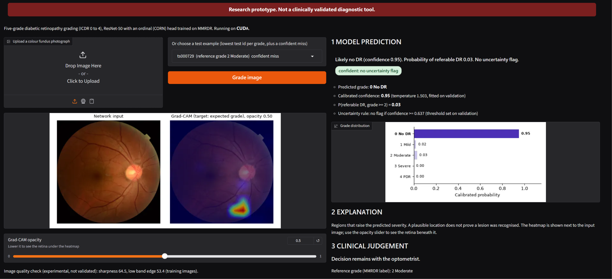
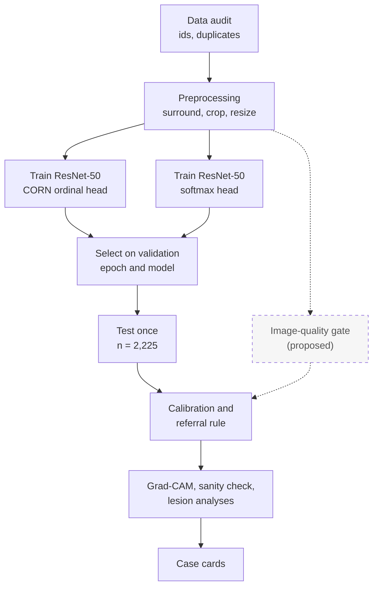
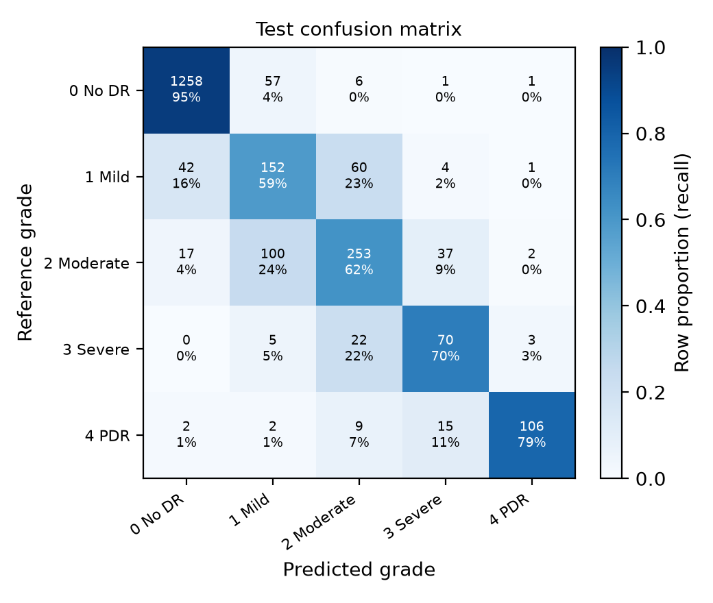
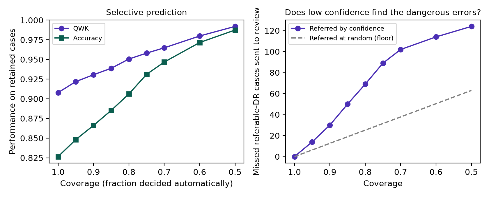
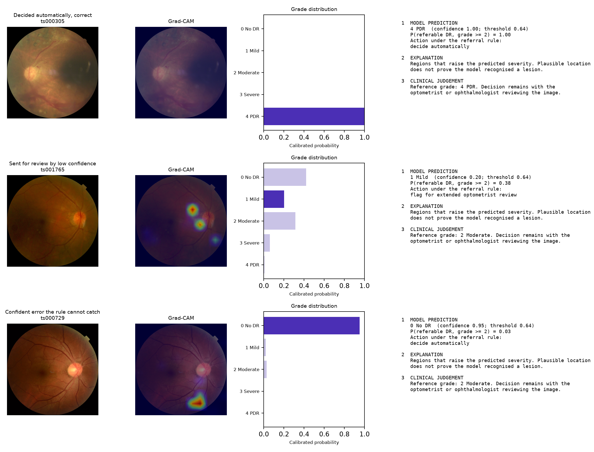
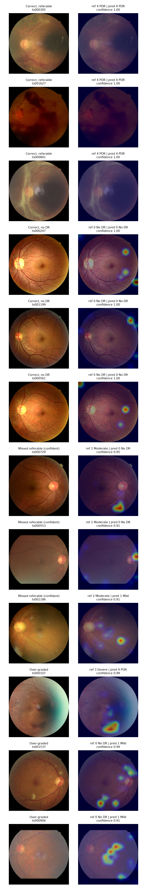
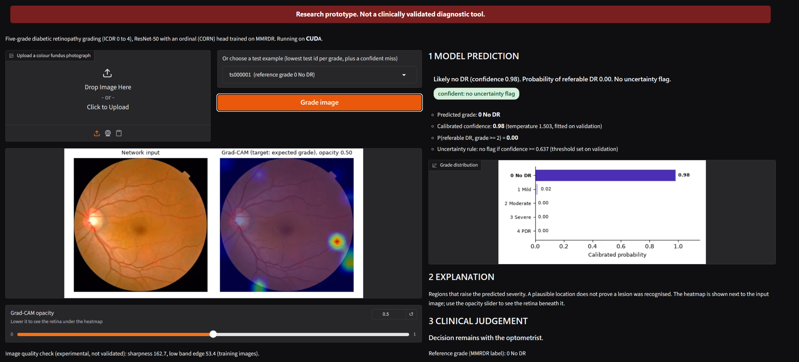
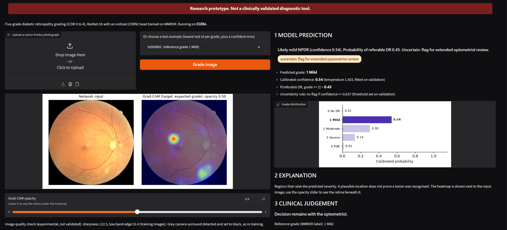
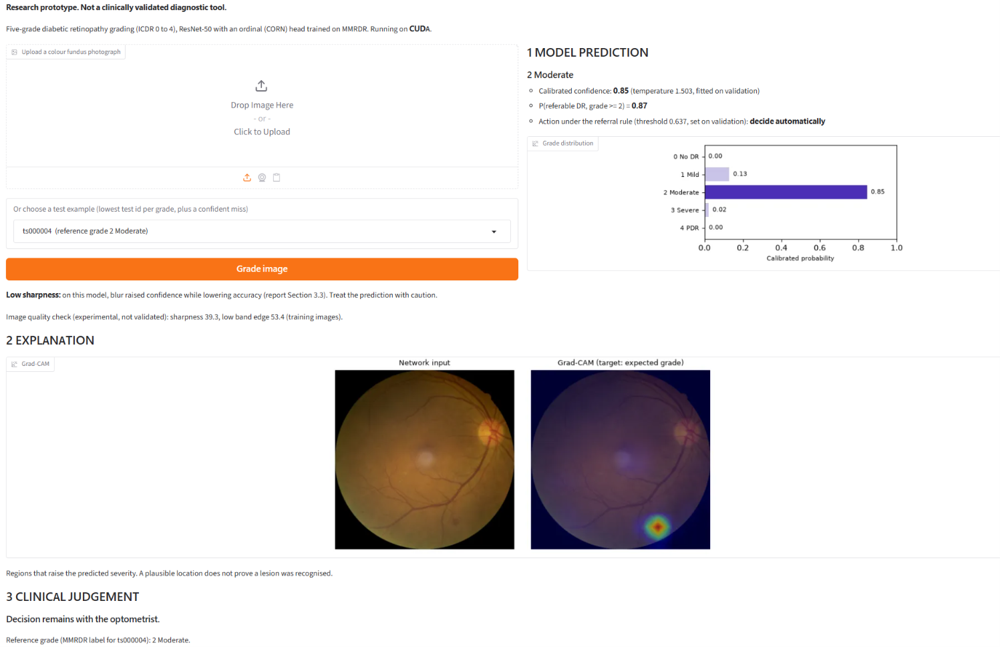

# Explainable diabetic retinopathy grading from colour fundus photographs

Five-grade diabetic retinopathy (DR) grading on MMRDR with calibrated confidence, a review rule for uncertain
cases, and explanations that are tested before they are trusted.

[](https://www.python.org/)
[](https://pytorch.org/)
[](LICENSE)
[](#limitations)

<p align="center">
  
  <br>
  <em>The demo app on ts000729: a referable eye graded "No DR" with confidence 0.95, the kind of error a confidence-based review rule cannot catch.</em>
</p>

This is a research prototype for AI-supported optometric triage, meant to help community optometrists
decide which patients need extended review. It is not a clinically validated diagnostic tool.

## Contents

- [How it works](#how-it-works)
- [Results at a glance](#results-at-a-glance)
- [Quick start](#quick-start)
- [Demo app (optional)](#demo-app-optional)
- [Data](#data)
- [Design decisions](#design-decisions)
- [Limitations](#limitations)
- [Acknowledgements](#acknowledgements)
- [Licence](#licence)

## How it works



Everything that is chosen (best epoch, model, temperature, review threshold, quality band edges) is
chosen on training or validation data. The test split is measured once, after those choices are fixed.

## Results at a glance

MMRDR official test split, n = 2,225. Brackets give 95% intervals from a grouped bootstrap over
near-duplicate clusters (2,000 draws). The floor always predicts grade 0, the commonest training grade.

| Test metric | Majority-class floor | Softmax (CE) | CORN (primary) |
|---|---|---|---|
| Quadratic weighted kappa | 0.000 | 0.909 (0.895 to 0.923) | 0.908 (0.893 to 0.921) |
| Accuracy | 0.595 | 0.831 (0.815 to 0.846) | 0.827 (0.811 to 0.842) |
| Macro-F1 | 0.149 | 0.725 (0.697 to 0.749) | 0.725 (0.699 to 0.748) |
| Referable DR (grade 2 or above) sensitivity / specificity | | 0.807 / 0.958 | 0.804 / 0.954 |
| Severe DR (grade 3 or above, n = 234) called grade 3 or above | | 0.846 (0.799 to 0.891) | 0.829 (0.782 to 0.877) |

CORN was chosen as primary on validation QWK (0.920 against 0.904). On test, the QWK difference (CORN
minus softmax) is -0.002 (-0.013 to +0.011): no demonstrated difference. The rest of this section uses CORN.

Key findings:

- **Blur raises confidence while accuracy falls.** Simulated blur at sigma 2 lowers accuracy from 0.827 to
  0.757 while mean confidence rises from 0.826 to 0.842 (point values, no interval).
- **The review rule helps but is not a safety net.** Sending the 20.5% least confident cases to review
  catches 70 of the 126 missed referable eyes, against 25.8 for random referral of the same number.
- **44% of missed referable eyes are confident.** 56 of the 126 sit above the review threshold, so
  confidence alone cannot catch them.
- **Errors cluster at the mild/moderate boundary.** 160 of the 386 errors (41%) are grade 1 called 2 or
  grade 2 called 1.

<table>
  <tr>
    <td width="50%"><br><em>Test confusion matrix</em></td>
    <td width="50%"><br><em>Accuracy as uncertain cases are referred</em></td>
  </tr>
</table>

<p align="center">
  
  <br>
  <em>Case cards: prediction, explanation and clinical judgement kept in separate panels. Bottom row: a confident miss the review rule cannot catch.</em>
</p>

<details>
<summary>Grad-CAM examples (12 test images: correct, missed and over-graded)</summary>
<p align="center">
  
  <br>
  <em>Grad-CAM, target: expected grade. A plausible location does not prove a lesion was recognised.</em>
</p>
</details>

<sub>Fundus images from MMRDR (Tang et al., 2026), CC BY 4.0.</sub>

<details>
<summary>More results: calibration, grey surround, explanation checks, lesion flags</summary>

- **Calibration.** A temperature of 1.503 (fitted on validation) lowers expected calibration error from
  0.056 to 0.025. The review threshold (confidence below 0.637) was set on validation for 80% automatic
  coverage. On test, 79.5% of cases carry no uncertainty flag, with accuracy 0.908 on those cases.
- **Error direction.** 55.4% of errors under-grade, which is the costly direction for triage.
- **Grey camera surround** (63 test images). Accuracy is 0.148 lower (-0.261 to -0.036), but these images
  are almost all grades 1 to 4. Standardised for grade mix, the gap is +0.017 (-0.104 to 0.132): no
  demonstrated surround effect. This is a post hoc analysis (`analysis/grey_standardised.py`).
- **Sanity check.** The median Spearman correlation between Grad-CAM maps from the trained model and from
  a copy with the explained block re-initialised is -0.012, so the maps depend on learned weights.
- **Lesion probe.** Six of seven lesion flags are more decodable from the DR-trained features than from
  ImageNet-only features, and every interval excludes zero (retinal detachment skipped: too few
  positives). Lesions rise with grade, so this shows the features encode lesions, not that grading uses them.
- **Missed referable eyes.** 125 of the 126 have microaneurysms flagged and 106 haemorrhages. No missed eye
  has vitreous haemorrhage or retinal detachment flagged.

Full tables: [results.md](runs/resnet50_corn/results.md),
[lesions_report.md](runs/resnet50_corn/lesions_report.md), [softmax results](runs/resnet50_ce/results.md),
[comparison](logs/compare.log). Other figures are in [runs/resnet50_corn/figures](runs/resnet50_corn/figures).

</details>

## Quick start

### Reproduce the headline numbers with the released weights

Training takes about three hours per model on a laptop GPU. With the released weights you only prepare
the data and evaluate (about 6 minutes for `evaluate --quality` on an RTX 3060 Laptop GPU).

1. Install (see below) and download MMRDR (see [Data](#data)).
2. Download `resnet50_corn_best.pt` from the
   [v1.0 release](https://github.com/AniketKiri/dr-grading-xai/releases/tag/v1.0) and check its SHA-256
   against the release notes.
3. Place it at `runs/resnet50_corn/checkpoints/best.pt`, then run:

```bash
set PYTHONNOUSERSITE=1
python -m drxai.prepare --workers 4
python -m drxai.evaluate --run runs/resnet50_corn --quality
```

Compare the printed table with [runs/resnet50_corn/results.md](runs/resnet50_corn/results.md). On the
GPU the grades should match. Confidences can differ slightly between machines, because
`cudnn.benchmark` and mixed precision are not bit-for-bit deterministic.

### Installation

Python 3.11 in a conda environment named `drxai`, with PyTorch from the pip CUDA 12.6 wheels:

```bash
git clone https://github.com/AniketKiri/dr-grading-xai.git
cd dr-grading-xai
conda create -n drxai python=3.11 -y
conda activate drxai
pip install torch torchvision --index-url https://download.pytorch.org/whl/cu126   # match your CUDA
pip install -r requirements.txt
pip install -e .
```

Set `PYTHONNOUSERSITE=1` before running anything, so that packages in the user site directory cannot
shadow the environment's own. `environment-lock.txt` lists the exact versions used.

### Full pipeline from scratch

```bash
python -m drxai.inspect_data
python -m drxai.prepare --workers 4
python -m drxai.train --run-name resnet50_corn
python -m drxai.train --run-name resnet50_ce --head ce
python -m drxai.evaluate --run runs/resnet50_corn --quality
python -m drxai.evaluate --run runs/resnet50_ce --quality
python -m drxai.compare --runs runs/resnet50_corn runs/resnet50_ce
python -m drxai.explain --run runs/resnet50_corn
python -m drxai.lesions_report --run runs/resnet50_corn
python analysis/grey_standardised.py
```

<details>
<summary>Every command, with what it writes and how long it took</summary>

Times are from the reported run on an RTX 3060 Laptop GPU (6 GB) with 16 GB RAM
(`logs/pipeline_status.txt`, `runs/*/history.csv`).

| Command | Writes | Time |
|---|---|---|
| `pytest tests/test_numerics.py tests/test_lesions.py` | nothing; hand-worked metric checks | about 20 s |
| `pytest tests/test_smoke.py -s` | nothing; every stage on synthetic data | about 2 min |
| `python -m drxai.inspect_data` | nothing; prints columns, grade counts, id-to-file matching | seconds |
| `python -m drxai.prepare --workers 4` | `cache/` images, `manifest.csv`, `near_duplicates.csv`, `integrity_report.json` | not recorded |
| `python -m drxai.train --run-name resnet50_corn` | `runs/resnet50_corn/` checkpoint, history, config used | 188 min (20 epochs) |
| `python -m drxai.train --run-name resnet50_ce --head ce` | `runs/resnet50_ce/` | 166 min (18 epochs, early stop) |
| `python -m drxai.evaluate --run runs/resnet50_corn --quality` | `metrics.json`, `results.md`, `predictions_test.csv`, `logits.npz`, figures | 6 min |
| `python -m drxai.evaluate --run runs/resnet50_ce --quality` | the same for the softmax run | 5 min |
| `python -m drxai.compare --runs runs/resnet50_corn runs/resnet50_ce` | `runs/comparison.json` (primary chosen on validation) | 13 s |
| `python -m drxai.explain --run runs/resnet50_corn` | Grad-CAM gallery, case cards, sanity check | 20 s |
| `python -m drxai.lesions_report --run runs/resnet50_corn` | `lesions_report.md/.json`, `lesion_consistency.csv`, lesion probe figure | 9.5 min |
| `python analysis/grey_standardised.py` | nothing; prints the post hoc grey-surround comparison | seconds |

</details>

<details>
<summary>Reproducibility notes and hardware</summary>

- Every run saves the configuration it used (`config_used.json`) and the library versions and GPU
  (`train_summary.json`). The seed is 42. `cudnn.benchmark` is on for speed, so GPU results can vary
  slightly between runs. `--seed` repeats a run with another seed.
- `logs/` holds the console output of every stage of the reported run. `logs/failed/` keeps two crashes
  caused by Windows memory limits and how they were fixed (fewer loader workers for training, none for
  inference; inference has no randomness, so no number changed).
- Hardware: Windows 11 laptop, NVIDIA RTX 3060 Laptop GPU (6 GB), 16 GB RAM. PyTorch 2.14.1 + CUDA 12.6,
  Python 3.11.18. Training uses 2 loader workers, because each Windows worker re-imports PyTorch
  (about 1.4 GB of committed memory) and 4 workers exhausted memory.
- The three notebooks in `notebooks/` (data exploration, results, explainability) only read files the
  pipeline has saved. They train nothing and compute no reported number.
- Model checkpoints are not committed; they are in the v1.0 release.

</details>

<details>
<summary>Repository layout</summary>

```
configs/default.yaml        every setting in one place
src/drxai/
    inspect_data.py prepare.py train.py evaluate.py compare.py explain.py lesions_report.py   the stages
    data.py labels.py lesions.py lesion_analysis.py ordinal.py metrics.py calibration.py      NumPy-only, unit-tested
    datasets.py model.py inference.py plots.py config.py
tests/
    test_numerics.py        hand-checked values for every reported metric
    test_lesions.py         hand-checked lesion-flag rules
    test_smoke.py           synthetic end-to-end run
analysis/grey_standardised.py   post hoc grade-standardised grey-surround comparison
demo/                       optional Gradio app, its check script and screenshots
notebooks/                  read-only exploration, results and explainability notebooks
runs/                       outputs of the reported runs (no checkpoints)
logs/                       console output of every stage
environment-lock.txt        exact package versions (pip freeze)
```

</details>

## Demo app (optional)

`demo/app.py` is a local Gradio page that grades one fundus photograph with the CORN model. It shows the
prediction, the Grad-CAM explanation and the clinical judgement as three separate panels, like the case
cards. It reuses the pipeline's own preprocessing, inference, temperature, review threshold and Grad-CAM.
Nothing reported depends on it.

It runs in a separate environment because Gradio 6.31.0 needs Pillow older than 13. Installing it into
`drxai` would replace the Pillow 13.0.0 that produced the reported results.

```bash
conda create -n drxai-demo --clone drxai
conda activate drxai-demo
pip install -r demo/requirements.txt
python demo/check_examples.py      # the six examples against predictions_test.csv
python demo/app.py
```

Then open http://127.0.0.1:7860. It needs `runs/resnet50_corn/checkpoints/best.pt` from the
[v1.0 release](https://github.com/AniketKiri/dr-grading-xai/releases/tag/v1.0), and the MMRDR images for
the built-in examples. It falls back to the CPU if no GPU is found.

What to try:

- **ts000729**, the confident miss: a moderate (referable) eye graded "No DR" with confidence 0.95, which
  the review rule does not flag ("confident: no uncertainty flag").
- **ts000004**, the low-sharpness warning: its sharpness (39.3) is below the training band edge (53.4).
  This check is experimental and has not been validated.
- **Upload your own colour fundus photograph.**

<table>
  <tr>
    <td width="50%"><br><em>Confident and correct</em></td>
    <td width="50%"><br><em>Uncertain: flagged for extended review</em></td>
  </tr>
  <tr>
    <td width="50%"><br><em>Confident miss (true grade 2)</em></td>
    <td width="50%"><br><em>Low-sharpness warning</em></td>
  </tr>
</table>

<sub>Fundus images from MMRDR (Tang et al., 2026), CC BY 4.0.</sub>

Precision note: for the six examples the crop is pixel-identical to the cached image and the grade
matches `predictions_test.csv`. Confidences differ slightly: by at most 0.0003 on the GPU, because the
app infers one image at a time under mixed precision while `evaluate` used batches of 32 (each example
matches exactly inside its original batch), and by at most 0.0013 on the CPU, which computes in full
precision. See `demo/check_examples_gpu.txt` and `demo/check_examples_cpu.txt`.

## Data

MMRDR (Tang et al., *Scientific Data*, 2026; doi:10.1038/s41597-026-07005-9) is on figshare under CC BY
4.0: doi:10.6084/m9.figshare.29423747. The full archive is about 18.6 GB across colour fundus, OCT and
ultra-widefield imaging. Only the colour fundus (CFP) subset is used. The dataset is not in this repository.

```
data/MMRDR/DatasetRT/MMRDR-CFP/
    img/        colour fundus photographs (tr000001.jpg ... ts002225.jpg)
    FP.csv      one row per image: grade, eye, image-level lesion flags
```

Set `paths.data_root` in `configs/default.yaml` if you place it elsewhere. `inspect_data` confirms the
column names, split encoding and lesion format from the data before anything else runs.

After `prepare`, 11,062 images are used: 7,574 train, 1,263 validation and 2,225 test. The official
train/test split is kept unchanged. Validation is one fold of a seven-fold stratified grouped split
of the training pool (14.3%).

## Design decisions

### Splits and duplicates

The official MMRDR split (`tr`/`ts` id prefix) is used unchanged, and the test
set is never modified. MMRDR releases no patient ids, so images of the same eye cannot be kept on one side
of a split. As a partial guard, `prepare` finds the same photograph stored under two ids (high-pass
fingerprint correlation): 169 such pairs. It keeps each pair in one group and drops the 56 training
images that copy a test image.

### Grey camera surround

317 of the 11,062 images have a dark grey surround (level about 20) rather than
black. In training and validation data these are 0.5% of grade 0 but 4.3% to 9.0% of grades 1 to 4
(`logs/grey_surround.txt`), so the border alone would hint at the grade. `prepare` estimates each image's
surround from its corners and sets a grey surround to black. Black-surround and white-canvas images are
processed exactly as before (checked byte for byte). The `grey_surround` manifest column keeps the flag so
test performance can be reported for that subgroup.

### Ordinal head

Grades are ordered, and QWK penalises distant errors more. The default head is CORN
(Shi, Cao and Raschka, 2023), which guarantees a monotone survival function. The predicted grade is the
median of the predictive distribution. A plain softmax head is the baseline.

### No hyperparameter search

Learning rate, schedule, batch size (16), input size (384) and epochs (20,
early stopping with patience 5) are standard fine-tuning defaults, fixed before training to fit a 6 GB
GPU. The one design choice compared is the output head, decided on validation.

### Imbalance

Training samples classes in proportion to the inverse square root of their frequency.
Full inverse weighting would show the few severe and proliferative images many times per epoch.

### Floors

Every headline metric is reported next to a majority-class floor and as a margin above it.
The referral curve is compared with referring the same number of cases at random.

### Calibration and review rule

One temperature, fitted on validation, is applied to confidences only.
For CORN, rescaling logits can move the predicted grade, so grades always come from raw logits. Cases
below the review threshold are flagged for extended optometrist review.

### Image quality

`prepare` records sharpness, brightness, contrast and field-of-view fraction. `evaluate`
reports performance in sharpness bands (edges from training images) and, with `--quality`, on test images
with simulated blur and under-exposure.

### Explanations

Grad-CAM (Selvaraju et al., 2017) on the last convolutional block, targeting the
expected grade, so maps show regions that raise the predicted severity. Checks against over-reading them:

- a model-randomisation test (Adebayo et al., 2018);
- case cards that keep prediction, explanation and clinical judgement in separate panels, including a
  confident error the review rule cannot catch;
- lesion-flag analyses (`lesions_report`): MMRDR gives seven present/absent lesion flags per image but no
  locations, so heatmaps cannot be scored spatially. Instead: grade-lesion consistency, a linear probe for
  each lesion against an ImageNet-only floor, and the lesions present in missed referable eyes.

### Integrity checks

`prepare` stops on any critical failure and records every check in
`cache/integrity_report.json`: grades in range, unique ids, each id resolving to exactly one image file,
duplicate detection with a guard against an over-eager detector, no group spanning two splits, readable
cached images, and a manifest round trip.

## Limitations

- **One dataset, one seed, no external validation.** All results are on MMRDR's own test split; nothing
  shows how the model behaves on other cameras or populations.
- **No patient identifiers.** Different photographs of the same eye may sit in both training and test,
  which would make test results optimistic. Only re-uses of the same photograph are detected.
- **The CORN model may not have converged.** Its best validation QWK came at the final epoch (20 of 20).
- **Labels.** 536 grade-1 images (4.8% of all images) have lesion flags beyond microaneurysms, which strict
  ICDR would grade higher. That suggests a grading convention rather than errors, but it blurs the
  mild/moderate boundary where errors cluster.
- **Confounded subgroups.** The 5 white-canvas images are all grade-4 training images. The grey-surround
  test subgroup has only 63 images, and image sharpness falls with grade.
- **Simulated quality.** The blur and exposure results use simulated degradation, not real poor images.
  The image-quality gate in the diagram is proposed, not implemented.
- **Explanations are not localisation evidence.** Without lesion masks, Grad-CAM maps cannot be checked
  against where lesions actually are.

## Acknowledgements

- MMRDR dataset, CC BY 4.0 (Tang et al., 2026). Example fundus images in figures and notebooks are from
  MMRDR and shown under that licence.
- ImageNet-pretrained ResNet-50 weights from torchvision.
- CORN ordinal regression: Shi, Cao and Raschka, *Pattern Analysis and Applications*, 2023.
- Grad-CAM: Selvaraju et al., ICCV 2017. Saliency sanity checks: Adebayo et al., NeurIPS 2018.
- PyTorch, torchvision, scikit-learn, SciPy, NumPy, pandas, Matplotlib, Pillow, Gradio.

## Licence

Code: MIT, see [LICENSE](LICENSE). The MMRDR data and images derived from it are CC BY 4.0
(Tang et al., 2026). Trained weights are derived from MMRDR; attribute the dataset when you use them.
